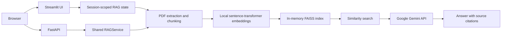

# DocuMind AI

DocuMind AI is a portfolio RAG application for asking questions about uploaded PDFs. It combines a Streamlit interface, a FastAPI HTTP API, PyMuPDF extraction, sentence-transformer embeddings, an in-memory FAISS index, and Google Gemini answer generation. This is an initial portfolio project, **not production-ready multi-tenant infrastructure**.

## Architecture



The Streamlit UI and API use the same ingestion, retrieval, and generation modules, but they do **not** share an index: Streamlit state is scoped to its Streamlit session, while the API owns one process-wide `default` collection shared by every API caller. Neither surface implements authentication, authorization, or tenant isolation.

## Features

- Upload, list, remove, and clear PDF documents. The API exposes a single in-memory `default` collection.
- Extract PDF text page by page, split it into chunks, and preserve page and source metadata for citations.
- Identify PDFs with no extractable text and report that OCR is needed; OCR itself is not implemented.
- Deduplicate identical content by SHA-256 and retrieve passages from FAISS.
- Ask grounded questions with Gemini and receive citations and request telemetry.
- Validate PDF extension, size, upload count, question length, and query options; return structured API errors.
- Configure provider timeouts and bounded retries; classify provider rate limits, timeouts, and upstream failures.
- Keep Gemini credentials in environment variables or a local `.env` file. They are not accepted from browser input.
- Run API and UI containers with Docker Compose.

## Requirements and setup

Python 3.12 is recommended. From the project root, create and activate a virtual environment and install the dependencies:

```powershell
python -m venv venv
.\venv\Scripts\Activate.ps1
python -m pip install -r requirements.txt
if (-not (Test-Path .env)) { Copy-Item .env.example .env }
```

Set `GEMINI_API_KEY` in `.env` for question answering. The default model is `gemini-3.8-flash`; if you already have a `.env`, keep your key and set `GEMINI_MODEL_NAME=gemini-3.8-flash`. Restart the app after changing `.env`. Health checks and PDF ingestion do not call Gemini. The first run downloads the embedding model from Hugging Face; allow network access and enough disk space for the model cache.

### Environment variables

| Variable | Default | Purpose |
|---|---|---|
| `GEMINI_API_KEY` | empty | Gemini credential; keep it out of source control and images |
| `APP_TITLE` | `DocuMind AI — Document Intelligence Assistant` | UI title |
| `DEBUG` | `False` | UI diagnostics default |
| `MAX_FILE_SIZE_MB` | `25` | Per-PDF upload limit |
| `MAX_UPLOAD_FILES` | `5` | Maximum files in one API upload |
| `MAX_QUESTION_LENGTH` | `1000` | Maximum question characters |
| `CHUNK_SIZE` | `1000` | Text chunk size in characters |
| `CHUNK_OVERLAP` | `200` | Text chunk overlap in characters |
| `EMBEDDING_MODEL_NAME` | `sentence-transformers/all-MiniLM-L6-v2` | Local embedding model |
| `GEMINI_MODEL_NAME` | `gemini-3.8-flash` | Gemini model |
| `RETRIEVAL_TOP_K` | `4` | Default number of retrieved chunks |
| `API_TIMEOUT_SECONDS` | `30` | Provider timeout (maximum `120`) |
| `API_MAX_RETRIES` | `3` | Provider retries (maximum `5`) |
| `CORS_ORIGINS` | `http://localhost:8501,http://127.0.0.1:8501` | Comma-separated explicit browser origins; `*` is rejected |

## Run locally

Start the Streamlit interface in a terminal from the project root. Activate the virtual environment first if it is not already active:

```powershell
python -m streamlit run app.py
```

Open <http://localhost:8501>.

To ask questions in the UI:

1. Upload one or more text-based PDF files in the left sidebar and wait for indexing to finish.
2. Type a question that can be answered from those documents in the chat box at the bottom.
3. Read the answer and its source citations. Use **Clear Chat** to keep the indexed PDFs but clear the conversation, or **Remove All** to clear both.

The first launch may take longer while the local embedding model downloads. PDF indexing is local; asking a question sends the question and retrieved passages to Gemini. Gemini requests require a valid API key, provider network access, and available quota. If the UI shows a provider overload or timeout, wait briefly and retry. If you change `.env`, stop the running Streamlit process with Ctrl+C and start it again so it loads the new settings.

```powershell
python -m uvicorn src.api.main:app --host 127.0.0.1 --port 8000
```

The health endpoint is <http://localhost:8000/health>; interactive API documentation is at <http://localhost:8000/docs>. Routes are available at `/api/v1/...` and at the existing root-level paths for compatibility.

### HTTP API

| Method | Path | Description |
|---|---|---|
| `GET` | `/api/v1/health` | Process health and model/index summary |
| `GET` | `/api/v1/collections/default` | Summary of the one API collection |
| `DELETE` | `/api/v1/collections/default` | Clear the API collection |
| `POST` | `/api/v1/documents/upload` | Multipart upload; use repeated `files` fields |
| `GET` | `/api/v1/documents` | List indexed documents |
| `DELETE` | `/api/v1/documents/{filename}` | Remove one document |
| `DELETE` | `/api/v1/documents` | Clear all indexed documents |
| `POST` | `/api/v1/query` | JSON body such as `{"query":"What does the document say?"}` |

Errors use an `{"error":{"code":"...","message":"...","details":...}}` envelope. Request validation returns HTTP 422, unsupported or invalid PDFs return 400, oversized uploads return 413, provider rate limits return 429, provider timeouts return 504, and other upstream provider errors return 502.

## Docker

Create `.env` and set `GEMINI_API_KEY`, then run:

```powershell
docker compose up --build
```

The API listens on <http://localhost:8000> and Streamlit on <http://localhost:8501>. Check API readiness at `/health`. To stop the services, press Ctrl+C and run `docker compose down`.

The Dockerfile defaults to the API service; Compose starts API and UI as separate processes. Their in-memory collections are separate. No uploaded PDFs or user indexes are included in the image or persisted. **Current FAISS indexes and extracted document content are in memory and are lost on process/container restart.** This application does not currently provide persistent storage. A deployment that adds persistence must store both the FAISS index and any retained source documents on a durable, access-controlled volume, protect backups, and implement tenant-aware authorization before serving multiple users. Do not mount a shared index between users.

## Tests and retrieval evaluation

Run automated offline tests:

```powershell
python -m pytest -q
```

Run live Gemini integration tests explicitly (requires a real `GEMINI_API_KEY` and provider network access):

```powershell
$env:DOCUMIND_RUN_LIVE_GEMINI_TESTS = "1"
python -m pytest -v -m integration
```

The live suite includes a generated sample PDF and exercises upload, retrieval, and a real Gemini answer through the FastAPI API. Live tests are skipped by default, including when a key is present, so the ordinary test suite remains offline.

The synthetic retrieval dataset is `eval/eval_dataset.json`. Run the retrieval-only evaluation with:

```powershell
python eval/evaluate_rag.py
```

This script reports retrieval measures only. It does not call the LLM or measure answer quality or abstention accuracy. Generated reports are ignored by Git.

## Deployment example: Render

No deployment is currently configured or claimed. To deploy the API as a single Render Docker web service:

1. Push this source to a repository you control and create a Render **Web Service** from it using the Docker runtime.
2. Set the health-check path to `/health`.
3. Configure `GEMINI_API_KEY` as a secret environment variable in Render. Set `CORS_ORIGINS` to the exact browser origins that need API access; do not use `*`.
4. Set any other required environment variables in the service configuration and deploy.
5. Verify the deployed `/health` endpoint and exercise document upload and query before sharing the service.

The current API is single-process and in-memory. Do not scale it to multiple instances or workers: each process has a different collection, and requests can reach a process without the caller's uploaded documents. Hosted ephemeral disks do not preserve data across restarts. Durable disks alone do not make this application multi-tenant or horizontally scalable.

## Security and limitations

- This is a portfolio prototype, not production-ready multi-tenant infrastructure. Neither API nor UI implements login, access control, tenant isolation, or user-specific API collections. Any caller who can reach the API can query or clear its shared collection.
- CORS is not authentication. Restrict network access separately when hosting.
- Uploaded PDFs and vectors are in process memory, not encrypted at rest, and not retained across restarts. Avoid sensitive documents.
- Gemini receives the question and retrieved PDF passages. Review provider data handling before uploading confidential material.
- Provider retries and timeouts are bounded, but there is no application-level request rate limiter, job queue, or distributed coordination.
- PDF text extraction handles digital text layers only; scanned PDFs require OCR.
- Embeddings run locally on CPU by default and may be slow for large documents.
- The root-level UI uses Streamlit session state, but this is not a security boundary or a substitute for authenticated tenant storage.

## Troubleshooting

- **Missing API key:** set `GEMINI_API_KEY` in `.env` (local) or the hosting platform's secret settings, then restart the service.
- **First launch is slow or fails while loading embeddings:** allow the process to download the configured Hugging Face model and check outbound network access and available disk/RAM.
- **Upload rejected:** confirm the file is a valid PDF, non-empty, under `MAX_FILE_SIZE_MB`, and that the API request does not exceed `MAX_UPLOAD_FILES`.
- **No extractable text:** the PDF may be scanned; OCR is not included.
- **Provider 429/502/504:** check the Gemini service/key/quota and retry after the reported provider delay; the API does not expose raw provider exception details.
- **Index disappeared:** the collection is in memory and is reset by process/container restarts.
